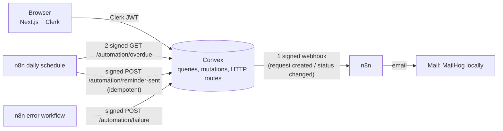

# LendLoop

A neighbourhood board for lending and borrowing tools. Built as a take-home exercise: **Next.js (App Router) + Clerk + Convex + n8n**, TypeScript throughout.

- Public page: company name, tagline, a read-only list of available tools (name and category only), and a "Sign in to lend or borrow" button wired to Clerk.
- Signed-in users: list a tool, browse everything with availability and a category filter, request to borrow for a date range, approve or decline requests on their own tools, mark a loan returned. Views: **My listings**, **My requests**, **Incoming requests**.
- Roles: `admin` (remove any listing, see all loans, mark a lender "Trusted Lender") and `user`. Rules are enforced inside the Convex functions, not only in the UI.
- Two n8n workflows plus an error workflow, signed in both directions (HMAC-SHA256), with retries, idempotent write-backs, and failures that show up in the admin tab.

> **Built with AI assistance.** This code was written by Claude Code, an LLM, at David Oyelade's direction (the brief allows LLM use). [What was tested, and what was not](#what-was-tested-and-what-was-not) lists what was actually run and what was not.

## Architecture



| Piece | Where | Notes |
| --- | --- | --- |
| UI | `src/` | Public landing page is server rendered from Convex; the dashboard is a client component with live queries. |
| Data and rules | `convex/` | `schema.ts`, `tools.ts`, `loans.ts`, `users.ts`; auth helpers in `lib/auth.ts`. |
| Automation (Convex side) | `convex/automation.ts`, `convex/http.ts`, `convex/lib/hmac.ts` | Signed delivery with retries, signed HTTP routes. |
| Automation (n8n side) | `n8n/workflows/*.json` | Generated from the readable Code node sources in `n8n/src/` by `npm run build:n8n`. |
| Tests | `tests/` | 38 tests (Vitest + `convex-test`). `scripts/n8n-smoke-test.mjs` checks the n8n side end to end. |

## Run it locally

You need Node 22, a free [Clerk](https://clerk.com) application, a free [Convex](https://convex.dev) account, and Docker for n8n.

1. **Install**

   ```bash
   npm install
   cp .env.example .env.local   # Next.js reads this
   cp .env.example .env         # docker compose reads this
   ```

2. **Clerk.** Create an application, copy the publishable and secret keys into `.env.local`. In the Clerk dashboard activate the **Convex** integration (it creates a JWT template named `convex`). Note the Frontend API URL (the "issuer"), for example `https://your-app-12.clerk.accounts.dev`.

3. **Convex.** In one terminal run `npx convex dev`. It creates a development deployment, writes `NEXT_PUBLIC_CONVEX_URL` to `.env.local`, regenerates `convex/_generated`, and keeps pushing your functions. Then set the deployment's environment (the three secrets come from `openssl rand -hex 32`, run it three times: n8n encryption key, webhook secret, callback secret):

   ```bash
   npx convex env set CLERK_JWT_ISSUER_DOMAIN https://your-app-12.clerk.accounts.dev
   npx convex env set ADMIN_EMAILS you@example.com        # set BEFORE you first sign in
   npx convex env set N8N_WEBHOOK_SECRET <webhook secret>
   npx convex env set N8N_CALLBACK_SECRET <callback secret>
   npx convex env set N8N_WEBHOOK_URL <public url of n8n>/webhook/lendloop-request
   ```

   Put the same two secrets in `.env`, plus `N8N_ENCRYPTION_KEY` and `CONVEX_SITE_URL` (your deployment's `.convex.site` URL, the HTTP Actions URL in the Convex dashboard).

   A cloud Convex deployment calls `N8N_WEBHOOK_URL` from the internet, so `localhost` will not work. Use a tunnel for the demo (for example `npx cloudflared tunnel --url http://localhost:5678`) and put that URL in `N8N_WEBHOOK_URL` and `WEBHOOK_URL`. A local Convex deployment can use `http://localhost:5678` directly.

4. **n8n.** `docker compose up`. A one-shot container imports the three workflows and an SMTP credential for MailHog, publishes them, and exits; then n8n starts on <http://localhost:5678> and MailHog on <http://localhost:8025> (every email lands there). n8n asks you to create an owner account the first time. The compose file pins `n8nio/n8n:2.8.4`, the version the workflows were run against.

5. **App.** `npm run dev`, open <http://localhost:3000>, sign in. Use a second browser profile (or a private window) with a second account to be the borrower.

6. **Try the notification flow.** Borrower: Browse, request a date range. The lender gets an email in MailHog. Lender: approve; the borrower gets one.

7. **Try the overdue flow.** The app refuses past dates on purpose, so use the dev helper to push an approved loan into the past, then run the workflow:

   ```bash
   npx convex env set ALLOW_DEV_TOOLS true            # development deployments only
   npx convex run dev:backdateLoan '{"loanId":"<loan id>","daysOverdue":2}'
   ```

   In n8n open **LendLoop - overdue reminders** and press **Execute workflow** (the schedule runs it daily at 09:00 UTC). The borrower gets a reminder, and the loan shows "Reminder sent just now" in the dashboard. Running it again the same day sends nothing: the write-back is idempotent and the report skips loans already reminded today.

### Environment variables

| Name | Where | Purpose |
| --- | --- | --- |
| `NEXT_PUBLIC_CLERK_PUBLISHABLE_KEY`, `CLERK_SECRET_KEY` | `.env.local` | Clerk |
| `NEXT_PUBLIC_CONVEX_URL` | `.env.local` | Convex client URL |
| `CLERK_JWT_ISSUER_DOMAIN` | Convex env | Lets Convex verify Clerk tokens |
| `ADMIN_EMAILS` | Convex env | Comma-separated emails that become `admin` on first sign-in, only if Clerk says the email is verified |
| `N8N_WEBHOOK_URL`, `N8N_WEBHOOK_SECRET` | Convex env | Where and how Convex signs outbound events |
| `N8N_CALLBACK_SECRET` | Convex env and n8n env | Verifies n8n's calls into Convex (and signs them on the n8n side) |
| `N8N_WEBHOOK_SECRET` | n8n env | Verifies Convex's calls into n8n |
| `CONVEX_SITE_URL` | n8n env | Base URL of the Convex HTTP routes |
| `NOTIFY_CHANNEL`, `MAIL_FROM` | n8n env | `email` (SMTP credential) or `log` (recipient and subject only); sender address |
| `ALLOW_DEV_TOOLS` | Convex env | Enables `dev:backdateLoan`; leave unset anywhere real |

## Roles and rules

| Action | Anonymous | User | Admin |
| --- | --- | --- | --- |
| See public list (name, category) | yes | yes | yes |
| Browse all tools, availability, owner display name | no | yes | yes |
| Create a listing | no | yes | yes |
| Edit or delete a listing | no | only own | only own (or remove any, below) |
| Request to borrow | no | not own tool | not own tool |
| Approve, decline, mark returned | no | only on own tools | only on own tools |
| Cancel a request | no | only own, only before an answer | only own |
| Remove any listing (open requests are cancelled) | no | no | yes |
| See all loans, automation issues, lenders | no | no | yes |
| Mark or unmark "Trusted Lender" | no | no | yes |

Business rules, all in Convex: no borrowing your own tool, no past start dates, maximum 30 days, maximum 5 open requests per borrower, no overlapping approved loans (re-checked at approval), a listing with open requests or loans cannot be deleted by its owner.

## The automation, in detail

**1. Request notification** (`request-notification.json`). Convex creates one `automationEvents` row per (loan, event type), then calls the n8n webhook with a signed JSON body: `{ eventId, type, loanId, status, toolName, startDate, endDate, recipient: { name, email }, otherParty: { name } }`. n8n reads the raw body, computes the HMAC, compares in constant time, checks the 5-minute window, and answers `401` on any doubt. Valid events are checked against a delivered-event list, rendered into a one-line subject and a short body, sent, and only then recorded as delivered. It answers `{"status":"sent"}`; Convex accepts only that (or `"duplicate"`) as success.

**2. Overdue reminders** (`overdue-reminders.json`). Daily at 09:00 UTC. n8n signs an empty-body `GET /automation/overdue`; Convex returns approved loans past their due date that have no `sent` reminder today (borrower name and email, tool name, due date, days overdue, and a `reminderKey` of the form `reminder:<loanId>:<date>`). For each loan n8n sends a reminder, then writes the result back to `POST /automation/reminder-sent`. The write-back is keyed by `reminderKey`: the first `sent` wins, repeats return `duplicate: true`, a `failed` result can be retried to `sent`. Stale or mismatched keys are refused. The bonus is in the UI: loans show "Reminder sent 2 days ago".

**3. Error handler** (`error-handler.json`). Set as the error workflow of both others. It posts a short signed report (workflow, node, message cut to 200 characters, execution id) to `POST /automation/failure`; Convex stores it once per execution and the admin tab lists it under **Automation issues**.

**Signing.** Header `x-lendloop-signature: t=<unix seconds>,v1=<hex>`, where `v1 = HMAC_SHA256(secret, "<t>." + rawBody)`. There is one secret per direction (`N8N_WEBHOOK_SECRET` Convex to n8n, `N8N_CALLBACK_SECRET` n8n to Convex). The same algorithm lives in `convex/lib/hmac.ts` and in the n8n nodes (a Crypto node computes the HMAC, a Code node does the constant-time compare). If a secret is missing, Convex answers `503` and n8n answers `401`; neither runs unsigned.

**Reliability.**

| Failure | What happens |
| --- | --- |
| n8n down or answers non-2xx or an empty 200 | Convex makes up to 4 attempts (immediately, then after 5 s, 30 s and 120 s), then marks the event `failed` with a reason. Admins see it. |
| Send fails inside n8n | Send node tries up to 3 times, then the workflow answers `502` (so Convex retries) and fails, which starts the error workflow. |
| Convex retries after a timeout, so n8n sees an event twice | n8n's delivered-event list answers `duplicate` without sending again. |
| A reminder email fails for one borrower | That loan is written back as `failed` and stays in the overdue report until a reminder is sent; the others still go out; the run is then failed on purpose so the error workflow reports it. |
| n8n retries a write-back | Same `reminderKey`, same result, no duplicate row. |
| Error workflow cannot reach Convex | It tries up to 3 times; after that the failure is only visible in n8n's execution list (error executions are kept). |

## Security and data minimisation

- **Identity and roles come from the server.** The user row is found by the Clerk subject in the verified JWT. No function takes a user id or role from the client. Admins are bootstrapped from the server-side `ADMIN_EMAILS` list and only when the identity provider reports the email as verified.
- **Every Convex function checks access itself** (`requireUser`, `requireAdmin`, ownership checks). Hiding a button is never the control. `tests/rbac.test.ts` calls each function as the wrong person.
- **Minimal data leaves each boundary.** The public query returns name and category only (no owner, no description, no ids). Signed-in browsing shows an owner's display name, never an email. The n8n webhook carries the recipient's name and email (needed to send) and the other person's display name, never their email or any internal id. The overdue report carries the borrower's name and email, and only over a signed route.
- **n8n keeps little.** Successful executions save no data; failed ones are kept for debugging; the compose file prunes executions after 7 days. In `log` mode only recipient and subject are logged, never the body.
- **Secrets stay out of code and exported JSON.** Workflows read `$env.*` at run time; the exported files contain only the SMTP credential's name and id. The repo contains no secrets; `.env` files are ignored.
- **Fails closed.** Missing secret, missing or malformed header, bad signature, expired timestamp: all rejected. Bodies over 4 KB are refused on write-back routes.
- **Input handling.** Dates validated as real calendar days; text trimmed and length-capped; subjects and names forced onto one line before they reach an email header.
- **User-facing errors use `ConvexError`**, so production deployments show the useful message while unexpected errors stay masked.

Known limits are in [PRODUCTION_NOTES.md](./PRODUCTION_NOTES.md).

## Tests

```bash
npm test            # 38 tests: RBAC, validation, HMAC, retries, HTTP routes, idempotency
npm run typecheck
npm run lint
npm run build       # needs dummy Clerk keys, see .github/workflows/ci.yml
```

The suite runs the real Convex functions in memory with `convex-test` (scheduler and `fetch` faked). The suite was checked for teeth by deliberately removing the lender check and the reminder idempotency check; both made tests fail.

The n8n side has a script that stands in for Convex using the real `verifySignature`/`signPayload` code:

```bash
export N8N_WEBHOOK_SECRET=... N8N_CALLBACK_SECRET=...      # same values n8n runs with
# n8n must have CONVEX_SITE_URL=http://host.docker.internal:3999 (or http://localhost:3999)
N8N_EXECUTE_CMD="docker compose exec -T -e N8N_RUNNERS_BROKER_PORT=5680 n8n n8n execute --id=lendloopRemind01" \
  npm run smoke:n8n
```

It checks a valid delivery, a duplicate, five kinds of bad signature, and the reminder write-back. Set `EXPECT_SEND_FAILURE=1` against an n8n that cannot send mail to check the failure path instead.

## What was tested, and what was not

Run on the development machine:

- 38 Vitest tests pass; `tsc`, `eslint` and `next build` pass.
- n8n **2.8.4** (installed with npm, not Docker): imported the credential and workflows with the n8n CLI, published them, and ran `npm run smoke:n8n` against it in `log` mode. All checks passed in both directions: n8n accepts Convex-style signatures and rejects the bad ones; Convex's real verifier accepts n8n's signed GET and POST. Also ran the failure paths (SMTP host unreachable): webhook answered `502`, the error workflow reported to the stand-in, the reminder was written back as `failed`.
- The landing page renders, shows its fallback when Convex is unreachable, and a signed-out visit to `/dashboard` redirects to `/`.

Not run, so treat these as unverified:

- **A real Convex deployment.** The local Convex backend binary would not download in this environment, and no Convex account was created. The functions ran under `convex-test`, which is faithful but not the real backend. `convex/_generated` was produced from the Convex CLI's own code generation templates; `npx convex dev` will overwrite it with its own output.
- **Clerk sign-in and the JWT template**, and therefore the signed-in dashboard in a browser. The UI code type-checks and builds, but nobody has clicked through it.
- **Docker.** There is no Docker on the development machine, so `docker-compose.yml` has never been started, including the import one-shot service.
- **Real email.** Only `log` mode was run end to end; the SMTP node was exercised only down its failure path.

## Project layout

```
convex/        schema, queries and mutations, automation, HTTP routes, HMAC helper
src/           Next.js app (landing page, dashboard, components)
n8n/src/       readable Code node sources
n8n/workflows/ importable workflows (generated: npm run build:n8n)
n8n/credentials/ SMTP credential for the local MailHog (no secrets)
scripts/       workflow builder, n8n smoke test
tests/         Vitest suites
```
